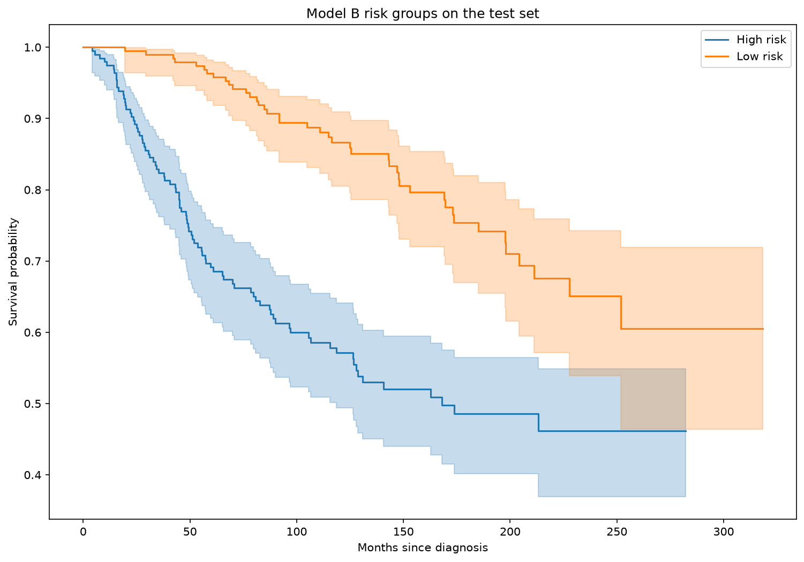
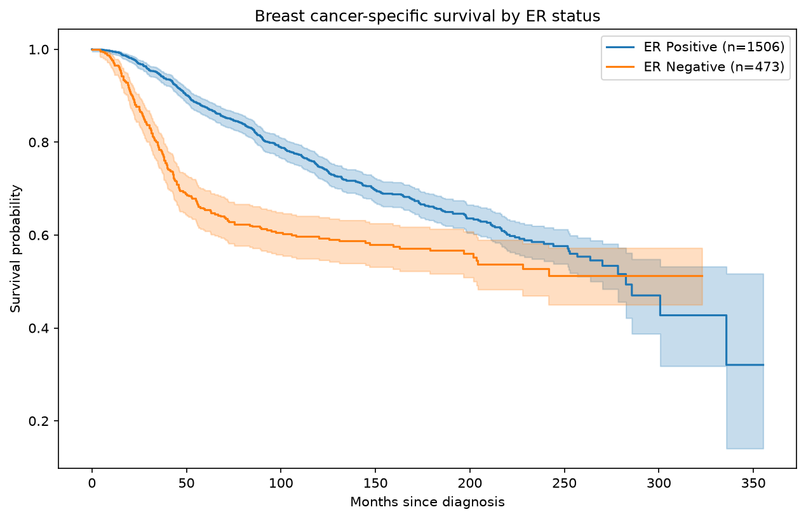
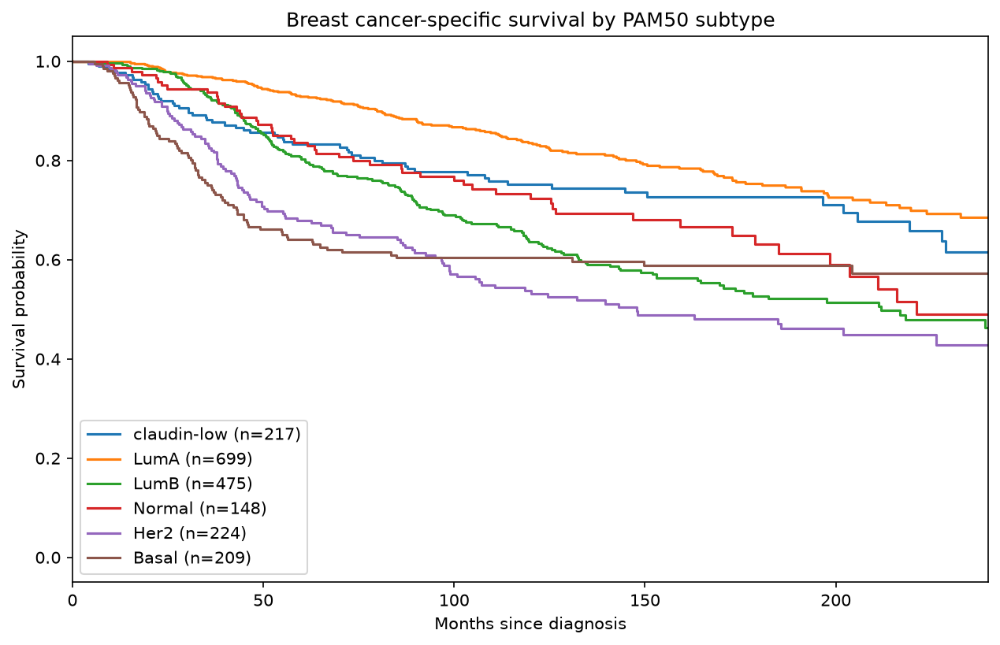
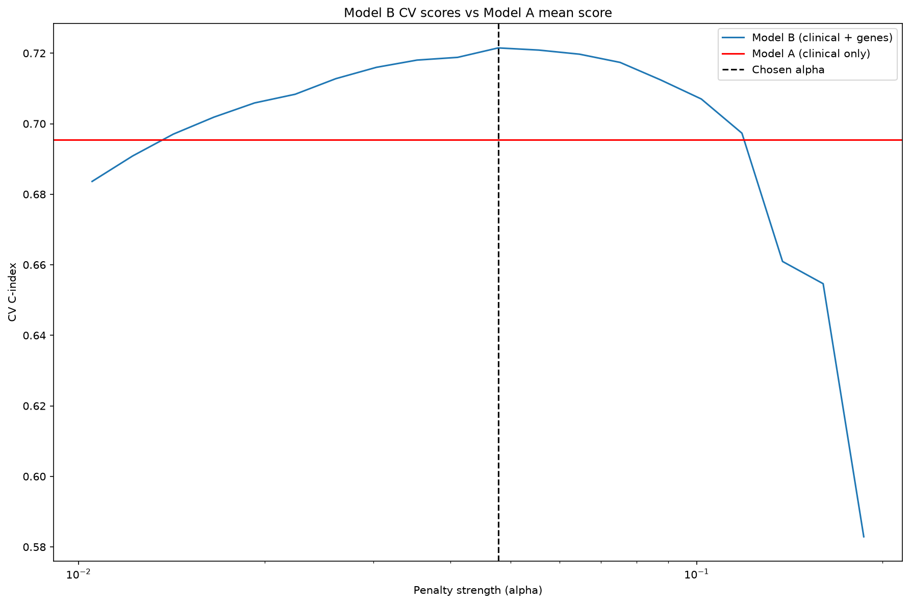

# Breast Cancer Survival: Clinical Data vs Gene Expression (METABRIC)

Can gene expression predict breast cancer survival better than the clinical information doctors already have?

This project compares two survival models on the public METABRIC cohort of breast cancer patients:
- **Model A:** a Cox model on clinical data only (age, tumour size, lymph nodes, grade, receptor status, histology)
- **Model B:** a penalised Cox model on the same clinical data plus the expression of 1,000 genes

## Key results

| Model | CV C-index (5-fold) | Test C-index |
|---|---|---|
| A: clinical only | 0.695 | 0.688 |
| **B: clinical + genes** | **0.721** | **0.733** |

- **Gene expression improves the prediction.** Model B ranks patients by risk better than model A, by about +0.03 in cross-validation and +0.05 on the held-out test set.
- **Model B uses only 22 of 1,011 features:** 20 genes, plus lymph nodes and tumour size. The penalty set all other coefficients to zero.
- **The selected genes are consistent with known breast cancer biology.** The strongest risk gene, CDCA5 (hazard ratio 1.14 per standard deviation), is involved in cell division, a marker of fast-growing tumours. SUSD3 (0.96, protective) is closely linked to the estrogen receptor. These genes appear to carry the information that grade and ER status provide in model A, which model B dropped.
- **Model B separates test patients into clearly different risk groups.** Split at the median risk score, 87% of the low-risk group but only 57% of the high-risk group were alive 10 years after diagnosis (log-rank p = 3.2 × 10⁻⁹).



## Data

- **Source:** METABRIC (Molecular Taxonomy of Breast Cancer International Consortium), from [cBioPortal](https://www.cbioportal.org/study/summary?id=brca_metabric). Patients were diagnosed between 1977 and 2005.
- **Files used:** clinical patient data, clinical sample data, and gene expression (Illumina microarray, log2 values)
- **Cohort:**

| Step | Patients |
|---|---|
| All patients in the study | 2,509 |
| With survival data | 1,980 |
| Without zero follow-up time | 1,979 |
| With gene expression (models) | 1,978 |

- **Outcome:** breast cancer–specific survival. The event is death from breast cancer (646 patients). Patients who were alive at their last follow-up (837) or died of other causes (497) are censored.
- **Gene expression:** 20,603 gene rows. 218 duplicate gene names (several probes for the same gene) were averaged, and 11 genes with missing values were removed, leaving 20,374 genes.

## Censoring

Survival data is often incomplete: for many patients, the exact time of the event is unknown. This is called censoring. There are three types:

| Type | What happened | What is known |
|---|---|---|
| Right censoring | Observation ended before the event | The event happens after time X, but not when |
| Interval censoring | The event happened between two check-ups | It happened between check-up A and check-up B |
| Left censoring | The event happened before observation started | It happened before time X, but not when |

A related problem is left truncation (delayed entry): a patient joins the study only some time after their risk started.

**In this project, only right censoring applies:**
- For patients alive at their last follow-up or who died of other causes, we only know that they did not die of breast cancer before their last follow-up.
- Kaplan-Meier curves, the log-rank test, the Cox model and the C-index all handle right censoring correctly.
- Interval censoring does not apply, because death dates are known exactly. It would apply to recurrence, which is only detected at check-ups.
- Left censoring and left truncation do not apply, because every patient's time starts at diagnosis.

## Methods

### Kaplan-Meier analysis

- **Own implementation:** the Kaplan-Meier estimator was written from the formula (`src/km.py`) and validated against `lifelines`. Both give identical survival estimates for all 1,979 patients.
- **Survival by group,** with log-rank tests:
  - **ER status** (p = 1.6 × 10⁻⁹): ER-negative patients die mainly in the first 5 years, while ER-positive patients have a steady risk for decades. The curves cross after about 23 years, where few patients remain.
  - **PAM50 subtype** (p = 1.2 × 10⁻¹⁸): Luminal A has the best survival; Basal and HER2-enriched have the worst in the first years.
  - **Grade** (p = 1.7 × 10⁻¹⁴): survival decreases clearly from grade 1 to grade 3.

| ER status | PAM50 subtype |
|---|---|
|  |  |

### Model A: clinical Cox model

- **Features:**
  - numeric: age at diagnosis, tumour size, positive lymph nodes, grade
  - categorical: ER, PR and HER2 status, menopausal state, histology (rare types grouped as "Other")
- **Not used as features:**
  - gene-based subtypes (PAM50, integrative cluster, 3-gene classifier), so that model A contains no gene information
  - treatments, because doctors choose them based on how risky the tumour looks, so they partly reflect the outcome
  - the Nottingham prognostic index, because it is calculated from tumour size, grade and lymph nodes, which are already in the model
- **Preprocessing:** median imputation and scaling for numeric features; most-frequent imputation and one-hot encoding (first category dropped) for categorical features
- **Model:** Cox proportional hazards (`scikit-survival`), with an 80/20 train/test split stratified by event and 5-fold cross-validation on the training set

**Hazard ratios** (per standard deviation for numeric features; 95% confidence intervals from `lifelines`):

| Feature | Hazard ratio | 95% CI |
|---|---|---|
| HER2-positive | 1.50 | 1.18–1.90 |
| Pre-menopausal (at the same age) | 1.40 | 1.02–1.93 |
| Positive lymph nodes | 1.31 | 1.24–1.38 |
| Age at diagnosis | 1.24 | 1.07–1.43 |
| Tumour size | 1.20 | 1.13–1.27 |
| Grade | 1.19 | 1.07–1.32 |
| Histology "Other" (vs ductal) | 0.44 | 0.24–0.83 |

HER2-positive tumours had a high risk because most patients in this cohort were treated before the HER2 drug trastuzumab became standard.

**Proportional hazards check:** the Cox model assumes that each feature's effect is constant over time. Tests on the Schoenfeld residuals showed:
- **ER and PR status violate this assumption,** as the crossing Kaplan-Meier curves suggest. A model stratified by ER and PR (separate baseline risk per group) was fitted to check the other hazard ratios. They changed by less than 5%, so the interpretation is robust.
- **Age** shows a mild time-varying effect: its influence increases slightly over follow-up time.
- The C-index comparison uses the unstratified model.

### Model B: penalised Cox model with gene expression

- **Features:** the same clinical features as model A, plus gene expression
- **Gene selection:** the 1,000 genes with the highest variance, selected inside the pipeline, so that the selection is fitted on training data only in every cross-validation fold
- **Model:** elastic net Cox model (`CoxnetSurvivalAnalysis`, mostly Lasso: `l1_ratio = 0.9`). The penalty shrinks most coefficients to exactly zero.
- **Tuning:** the penalty strength (alpha) was chosen with 5-fold cross-validation on the training set, using the same folds as model A



Too strong a penalty keeps too few features (underfitting); too weak a penalty keeps too many genes (overfitting). Model B beats model A over a wide range of penalty strengths.

## Limitations

- **One cohort, no external validation.** The test set comes from the same study. Performance on patients from other hospitals or newer treatment eras is unknown.
- **Historical treatment.** Patients were diagnosed between 1977 and 2005. Modern treatments, especially for HER2-positive cancer, change the risk of some groups.
- **Microarray data.** Gene expression was measured with a microarray platform. Results may differ with RNA sequencing.
- **Associations, not causes.** The selected genes are associated with survival in this model. Correlated genes can replace each other, so a different gene set could perform equally well.
- **Proportional hazards** is violated by ER and PR, and mildly by age (see above).
- **Median split.** The risk groups use the median of the test set's risk scores. A clinical tool would need a fixed, pre-defined cutoff.

## Project structure

```
src/01_load_and_clean.ipynb    clinical data: cleaning, cohort, survival outcome
src/02_kaplan_meier.ipynb      own Kaplan-Meier, validation, survival by group
src/03_gene_expression.ipynb   gene expression: reshaping, duplicates, missing values
src/04_cox_models.ipynb        model A, proportional hazards checks, model B, risk groups
src/km.py                      own Kaplan-Meier implementation
data/raw/                      METABRIC files (not in git, see below)
data/processed/                cleaned tables (expression.parquet is not in git, too large)
reports/figures/               saved figures
```

## How to run

1. Create an environment with Python 3.12 and install the packages: `pip install -r requirements.txt`
2. Download the METABRIC study from [cBioPortal](https://www.cbioportal.org/study/summary?id=brca_metabric) (download icon next to the study name). Copy these files into `data/raw/`:
   - `data_clinical_patient.txt`
   - `data_clinical_sample.txt`
   - `data_mrna_illumina_microarray.txt`
3. Run the notebooks in order, from `src/`: `01` → `02` → `03` → `04`. The model B grid search takes a few minutes.

## Stack

Python, pandas, NumPy, scikit-learn, scikit-survival, lifelines, matplotlib
